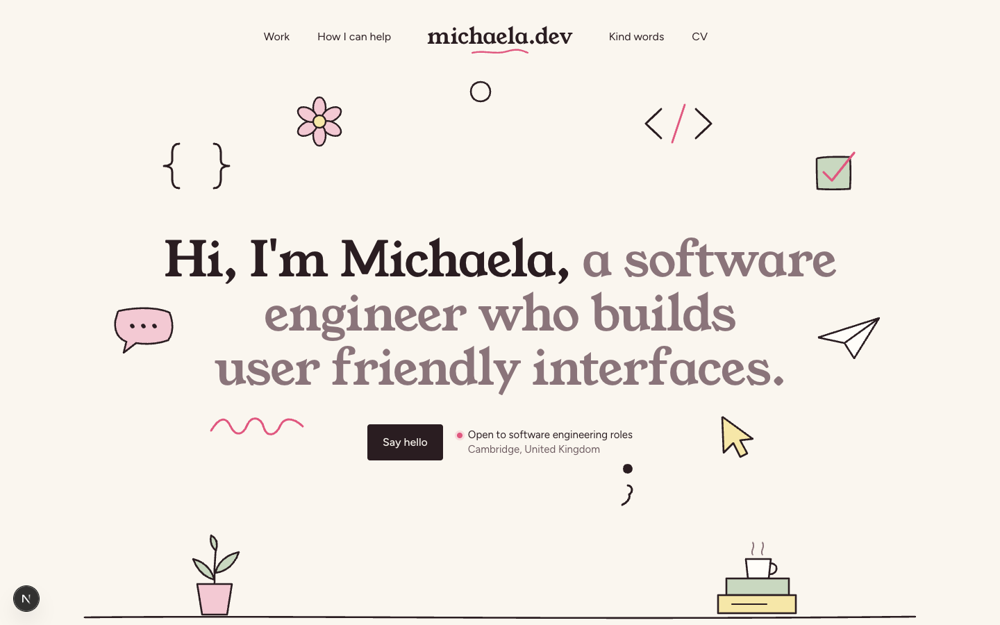

# michaela

My personal portfolio: a one-page site with hand-drawn doodles you can pick up and fling, project cards that play a preview on hover, and a contact form that emails me.



## Stack

- **[Next.js 16](https://nextjs.org)** (App Router) with **React 19** and **TypeScript** in strict mode. The page is prerendered as static HTML; only the contact form's route handler runs on the server.
- **[Tailwind CSS v4](https://tailwindcss.com)** with a small custom design system in [`app/globals.css`](app/globals.css). Tailwind's default colours, shadows, radii and text sizes are switched off, so only the project's own tokens are available.
- **[Motion](https://motion.dev)** for animation, loaded lazily so it stays out of the initial bundle. Dragging is only downloaded on devices with a mouse or trackpad.
- **[Resend](https://resend.com)** for delivering contact form messages.
- **[Vitest](https://vitest.dev)** and **[React Testing Library](https://testing-library.com)** for unit and component tests, **[Playwright](https://playwright.dev)** for end-to-end tests, and **[Lighthouse CI](https://github.com/GoogleChrome/lighthouse-ci)** for performance and accessibility budgets.

## Running it

You need Node 24 (see [`.nvmrc`](.nvmrc); with nvm, run `nvm use`).

```bash
npm install
npm run dev
```

Then open [http://localhost:3000](http://localhost:3000).

### Contact form

The contact form sends through [Resend](https://resend.com). Without these variables, `/api/contact` answers 503. Put them in `.env.local` locally, or in your host's environment settings in production:

```bash
RESEND_API_KEY=re_xxx                             # Resend → API Keys
CONTACT_FROM="Portfolio <hello@yourdomain.com>"   # must be on a domain verified in Resend
CONTACT_TO=you@example.com                        # where messages are delivered
```

To test before you've verified a domain, use `onboarding@resend.dev` as the sender. In that case `CONTACT_TO` must be the email address on your Resend account. Restart the dev server after you change env files.

## Scripts

| Command | What it does |
|---|---|
| `npm run dev` | Starts the development server |
| `npm run build` | Builds the production site |
| `npm run start` | Serves the production build |
| `npm run lint` | Runs ESLint |
| `npm run typecheck` | Generates Next.js route types, then type-checks |
| `npm test` | Runs the unit and component tests once |
| `npm run test:watch` | Reruns tests as files change |
| `npm run test:e2e` | Runs the Playwright tests against the production build (run `npm run build` first) |
| `npx lhci autorun` | Runs Lighthouse three times and checks the budgets (run `npm run build` first) |

## Editing content

All the words, links and projects live in [`content/`](content), so the site can be updated without touching a component:

- [`content/site.ts`](content/site.ts): name, headline, availability, email, links and the copy for each section.
- [`content/projects.ts`](content/projects.ts): the Selected work cards. Give a project a `video` and its card plays a muted preview on hover; without one it stays a still.
- [`content/notes.ts`](content/notes.ts): testimonials. The Kind words section adapts to zero, one or several notes.

## Project structure

```
app/            layout, the page, metadata routes, 404 and the contact route handler
components/
  doodles/      the hand-drawn SVGs and the Doodle wrapper (draw-in, wiggle, drag)
  sections/     Header, Hero, Work, Help, KindWords, Contact, Footer
  ui/           small shared pieces
content/        everything editable
lib/            motion presets, form validation, email sending
tests/          unit tests (Vitest) and end-to-end tests (Playwright)
```

## Accessibility and motion

- Semantic landmarks, real buttons and links, visible focus rings and 44px touch targets throughout.
- The mobile menu and message form are native modal dialogs, so focus is trapped, Esc closes them and focus returns to where it was.
- Every animation respects `prefers-reduced-motion`: doodles appear already drawn, text appears in place and smooth scrolling is turned off.
- Project videos are not downloaded until someone hovers, focuses or taps Preview.

One known exception: the availability dot in the hero pulses continuously, which does not meet WCAG 2.2.2 (Pause, Stop, Hide). It is a deliberate choice, and it is switched off for reduced-motion users.

## Quality checks

Every pull request runs lint, type-checking, unit tests, a production build, Playwright and Lighthouse CI through [GitHub Actions](.github/workflows/ci.yml). The build fails if any Lighthouse category drops below 95.

Lighthouse scores, mobile, production build run locally on 12 October 2026 (three runs):

| Performance | Accessibility | Best practices | SEO |
|---|---|---|---|
| 97 to 99 | 100 | 100 | 100 |
